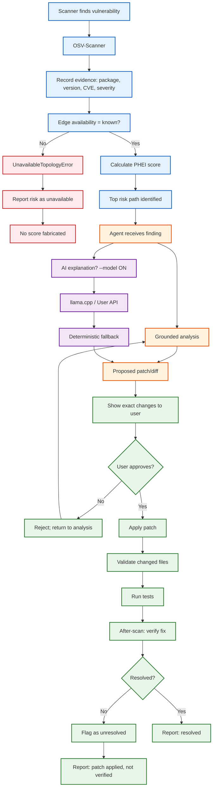

# Finding-to-Approved-Patch Workflow

> Mermaid source. Paste into a Mermaid renderer or `docs/diagrams/patch-workflow.mmd` for version control.

## Workflow rules

| Step | Rule |
|------|------|
| S4 (topology) | If `edge_availability != "known"` → `UnavailableTopologyError`. No score fabricated. |
| S13 (show patch) | Show **exact** changes to the user before applying. |
| S14 (approval) | Apply **only** after user explicitly approves that specific patch. |
| S19 (verify) | Claim resolved **only** when after-scan supports it. |
| S24 (AI) | `--model ON` required. Model output is additive only (never modifies findings). |
| S26 (fallback) | Deterministic fallback on any failure (no config, network, non-2xx, malformed, empty). |

## Key constraints

- **No faculty/sponsor approval step in runtime**: only the user approves patches.
- **No fabricated CVE data**: all findings from OSV-Scanner.
- **No fabricated edges**: topology must be `"known"` for PHEI.
- **No model training or fine-tuning**: out of scope.
- **Flask+D3 optional**: stdlib `src.web` dashboard is the default.
- **Docker optional**: manual install via `requirements.txt` is sufficient for the demo.

## Notes

- The workflow is the **product's** runtime behavior, not a Hermes configuration.
- Flask+D3 is optional — the stdlib `src.web` dashboard is sufficient for the December demo.
- Docker packaging is optional — manual install via `requirements.txt` is sufficient.
